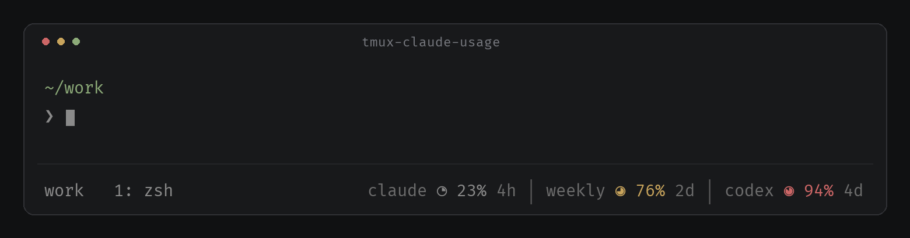

# tmux-claude-usage

Subscription usage in your tmux status bar: compact gauges, color-coded percentages, and time until reset. Supports live ChatGPT/Codex and Cursor subscription data, plus the original local Claude and Codex harvesters.

## Live ChatGPT and Cursor subscriptions

Requires Python 3 and curl in addition to tmux. The live mode reuses the existing renderer and runs network requests in a background collector, never in the status-line render path.

```tmux
set -g @agent_usage_providers "chatgpt,cursor"
set -g @agent_usage_chatgpt_label "openai"
set -g @agent_usage_chatgpt_window "weekly"
set -g @agent_usage_cursor_label "cursor"
set -g @agent_usage_refresh_interval 60
set -g @claude_usage_style "gauge"
set -g @claude_usage_show_reset "on"
set -g status-interval 10
set -g status-right '#{claude_usage} '
run-shell "$HOME/code/tmux-agent-usage/claude-usage.tmux"
```

Clone this repository to `~/code/tmux-agent-usage` for the path above, or adjust the entry-point path to your installation. The ordered `@agent_usage_providers` list enables live mode and supersedes the legacy Claude/Codex switches. Omit it to retain the local-only behavior.

- **OpenAI** reads the account's Codex subscription limits from `https://chatgpt.com/backend-api/wham/usage`. The provider id stays `chatgpt`. `weekly` selects the long limit window; `current` selects the short window. Windows are identified by duration, not by primary/secondary position. Separate model budgets and credit balances are not substituted for subscription limits. This is not a percentage of every feature in the ChatGPT website: those features can have separate quotas.
- **Cursor** reads the included-usage meter shown in the dashboard from `https://cursor.com/api/dashboard/get-current-period-usage`, using `planUsage.totalPercentUsed`. Reset time is that period's `billingCycleEnd`, including a weekly included-usage window. The older `usage-summary` plan total is a different meter and is only a fallback. A fractional value such as `0.36` means 0.36%, not 36%. The status line rounds the percentage to the nearest integer.
- ChatGPT credentials are read from `${CODEX_HOME:-~/.antex}/auth.json`, then `~/.codex/auth.json`, with Pi's `openai` access token as a fallback when its OAuth scopes permit usage access. For an expired Antex access token, the collector delegates renewal to the installed `antex app-server` (`account/read` with `refreshToken`), rather than rotating refresh tokens itself.
- Cursor credentials are read from Pi's `~/.pi/agent/auth.json` (`cursor.access`). Credentials are reread on each refresh and never copied into usage caches, logs, or process arguments. Expired/revoked credentials require the corresponding provider's normal login/refresh flow.
- Refresh defaults to 60 seconds (minimum 15), with atomic per-provider caches and nonblocking single-writer locks. Updates are triggered by status-line redraws, so keep a reasonable `status-interval`. A successful fetch appears on the next redraw.
- `?` means no usable reading, a missing window, or an expired billing/limit window. `~` after a reading means the last request failed or the reading is older than two refresh intervals. A failed request preserves the last successful reading; a passed reset is never silently presented as a fresh 0%.

For networks with broken Cursor DNS, an explicit curl resolution override is available:

```tmux
set -g @agent_usage_cursor_resolve "cursor.com:443:76.76.21.21"
```

This changes only the collector's connection routing, preserves TLS hostname verification, and does not change system DNS or `/etc/hosts`. Leave it unset on a working network; an IP override may need updating if Cursor changes its hosting.

To force a diagnostic refresh without exposing credentials:

```sh
python3 scripts/subscriptions.py --force
cat ~/.cache/claude-usage/subscriptions/{chatgpt,cursor}
```

Pass `--cursor-resolve cursor.com:443:76.76.21.21` to the diagnostic collector as well if you use that override. Cache `STATUS` values distinguish authentication, network, and missing-data failures.

Run the regression tests with `python3 -m unittest discover -s tests`, and lint shell scripts with `shellcheck --severity=warning scripts/*.sh claude-usage.tmux`.



*Preview with sample values: Claude’s 5-hour window, Claude’s weekly budget, and Codex’s weekly budget. Percentages show usage consumed; countdowns show time until reset.*

## Install & configure

Requires **tmux 3.0+**, **jq**, and a **Nerd Font v3+** selected in your terminal. Your Claude Code / Codex sessions must provide usage limit data.

```sh
git clone https://github.com/alchemmist/tmux-claude-usage.git \
  ~/.tmux/plugins/tmux-claude-usage
bash ~/.tmux/plugins/tmux-claude-usage/scripts/init.sh
```

The installer connects Claude Code’s usage harvester, backs up its settings, and preserves an existing status line. Codex usage is read automatically from local session logs.

Add this to `~/.tmux.conf`, after your theme settings:

```tmux
set -g @claude_usage_style gauge
set -g @claude_usage_claude on
set -g @claude_usage_claude_show all
set -g @claude_usage_show_reset on
set -g @claude_usage_icon claude
set -g @claude_usage_weekly_icon weekly
set -g @claude_usage_codex on
set -g @claude_usage_codex_show weekly
set -g @claude_usage_codex_icon codex

set -g @claude_usage_color_normal "#8a8a8a"
set -g @claude_usage_color_warning "#c8a45c"
set -g @claude_usage_color_critical "#cc6666"
set -g @claude_usage_label_color "#6c6c6c"
set -g @claude_usage_separator "#[fg=#585858] │ #[default]"

set -g status-right-length 120
set -g status-right '#{claude_usage} '
set -g status-interval 5

run-shell ~/.tmux/plugins/tmux-claude-usage/claude-usage.tmux
```

Reload with `tmux source-file ~/.tmux.conf`, then use Claude Code and Codex normally to populate the readings. Claude updates when its status line renders; Codex checks the most recently modified sessions and caches the reported windows for 60 seconds. It selects the standard Codex limit and skips separate model budgets such as Spark. Reloading the tmux config forces a fresh Codex scan, bypassing the 60-second cache. Missing windows stay hidden.

Using **TPM**? Replace the `run-shell` line with `set -g @plugin 'alchemmist/tmux-claude-usage'`, keep TPM initialization last, and press `prefix + I`. Run `scripts/init.sh` once after installation.

Choose each assistant and its windows independently:

| Option | Values | Default |
| --- | --- | --- |
| `@claude_usage_claude` | `on`, `off` | `on` |
| `@claude_usage_codex` | `on`, `off` | `off` |
| `@claude_usage_claude_show` | `weekly`, `current`, `all` | `current` |
| `@claude_usage_codex_show` | `weekly`, `current`, `all` | `weekly` |

`current` means the short usage-limit window (5 hours for Claude), not context-window usage. `all` shows current and weekly together. Codex only displays windows present in its session data. To name its weekly window separately, set `@claude_usage_codex_weekly_icon "codex weekly"`.

For example, show both assistants’ weekly limits with both switches `on` and both `_show` options set to `weekly`. Set either `_show` to `all` to add its current usage, or set an assistant to `off` to hide it.

Older configs using `@claude_usage_show` and `@claude_usage_codex_only` still work; the explicit Claude options above take precedence.

If Claude stays blank, run `bash ~/.tmux/plugins/tmux-claude-usage/scripts/init.sh --check`.

Fork of [docker-run/tmux-claude-usage](https://github.com/docker-run/tmux-claude-usage), adding Codex usage and compact gauges. [MIT](LICENSE).
